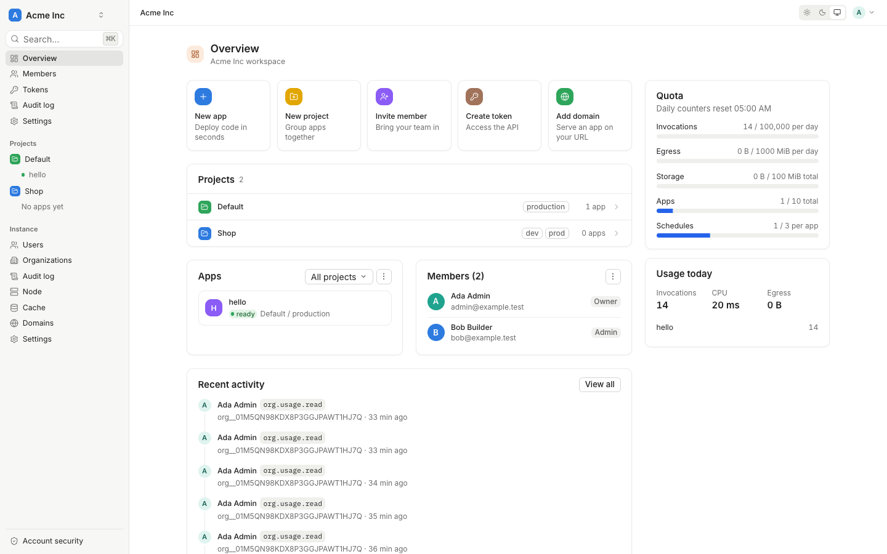

<p align="center">
  
</p>

<p align="center">
  <a href="https://21-ci.github.io/runtime-web/"></a>
  <a href="LICENSE"></a>
</p>

<p align="center">
  <b>A self-hosted console for writing, deploying and running small apps on 21 Cloud Runtime.</b><br>
  Think val.town, but on a runtime you run yourself: one place for users, orgs, projects, apps, logs, triggers,
  tokens and domains.
</p>

<p align="center">
  <a href="https://21-ci.github.io/runtime-web/">Docs</a> ·
  <a href="#quick-install">Quick install</a> ·
  <a href="#development">Development</a> ·
  <a href="SECURITY.md">Security</a> ·
  <a href="CONTRIBUTING.md">Contributing</a> ·
  <a href="https://github.com/21-ci/runtime">21 Cloud Runtime</a>
</p>

---

## Why

[21 Cloud Runtime](https://github.com/21-ci/runtime) runs tenant code safely and densely, but a runtime is an API,
not a product. Writing an app means a repo, a deploy command, a token, a log tail and a domain. Runtime Web puts all
of that in one browser console, for your team, on your own machine or cluster.

It is the human side of the runtime. Everything the console does goes through the runtime's API, so anything you can
click here you can also script.

## Features

| | |
|---|---|
| **Orgs, projects, members** | Organizations with owner, admin and member roles; projects inside an org; per-project admin, developer and viewer roles for each member |
| **Apps** | Create an app from a template, edit its code, see its version history and roll back, read its settings (limits, scaling, ingress and egress rules, access) |
| **Editor** | In-browser TypeScript editor with type checking against the runtime's guest API, a file tree and save with conflict detection |
| **Logs** | Live log stream over Server-Sent Events, filtered by level, with per-app stats |
| **Triggers** | HTTP routes, interval and cron schedules, and the app's durable queue with its dead-letter queue, all managed from one page |
| **Config** | Environment variables, write-only secrets, and the rules that decide who can call an app |
| **Tokens** | Default org keys plus scoped custom tokens, shown once on creation and never again |
| **Domains** | Custom domains with DNS TXT verification, mapped to apps as runtime custom hosts, with on-demand TLS from Caddy (ACME) |
| **Security** | Password login with TOTP two-factor auth, GitHub, Google and generic OIDC sign-in, session and CSRF protection, org-scoped audit log |
| **Admin** | Instance admin console: users, orgs, invites, runtime node status, cache, instance settings, domains and audit |

## Quick install

On a Linux host (x86_64 or aarch64) with Node.js 22.5+ and Caddy:

```bash
curl -fsSL https://raw.githubusercontent.com/21-ci/runtime-web/main/install.sh -o install.sh
sudo sh install.sh --domain console.example.com --email ops@example.com
```

`install.sh` installs a 21 Cloud Runtime node when `rt` is missing, downloads a signed release (SHA256SUMS, cosign
bundle), adds the `rtweb` plan and bindings to the node, puts Caddy in front with on-demand TLS, and deploys the
console as an App on the node with `server/scripts/install.mjs`. It prints a one-time setup token; open
`https://<domain>/setup` to finish. `--dry-run` shows every step without changing the host. Full steps:
[Install](https://21-ci.github.io/runtime-web/getting-started/install/).

## Architecture

```
browser ──► Caddy (TLS) ──► runtime invoke listener ──► rtweb service (SPA + API, TypeScript)
                                     │                          │ sdk("rtctl")
                                     └── app hosts / custom     ▼
                                         domains ──► apps   runtime control API (bindings rtctl-op,
                                                            rtctl-tenant via the Caddy relay)
```

- **Console**: a React single-page app (`web/`) embedded into the `rtweb` service (`server/`), a TypeScript backend
  that runs as an App on 21 Cloud Runtime. State lives in the service's `std:sql` and `std:kv`.
- **Runtime**: runs the apps, owns their code, storage, schedules and queues, maps custom hosts and enforces limits.
- **Caddy**: terminates TLS for the console and app domains (on-demand certificates gated by the console) and relays
  tenant-scoped control-API calls.

Design: [Architecture](https://21-ci.github.io/runtime-web/contributing/architecture/). Trust boundaries:
[Security model](https://21-ci.github.io/runtime-web/security-model/).

## Development

You need Node.js 22.5+ and GNU make. For a live deploy, a local 21 Cloud Runtime node.

```bash
make help        # list targets
make ci          # web build/lint/tests and budgets, server typecheck/lint/tests
make coverage    # web + server tests with coverage thresholds
make server-deploy   # dev deploy to a local runtime node (needs RT_ROOT_TOKEN)
make e2e         # Playwright smoke against a hosted console (needs RTWEB_URL)
```

The console's tests run against MSW handlers, the server's against an in-memory harness (node:sqlite, fake
runtime), so neither needs a runtime node. Configuration:
[Configuration](https://21-ci.github.io/runtime-web/configuration/). CI, security scans and signed releases:
[CI and releases](https://21-ci.github.io/runtime-web/contributing/ci-cd/). Local docs preview:

```bash
pip install -r docs/requirements.txt
mkdocs serve
```

For agents and contributors, read [AGENTS.md](AGENTS.md) and [CONTRIBUTING.md](CONTRIBUTING.md).

## Documentation

- [User guide](https://21-ci.github.io/runtime-web/user-guide/): orgs, projects, apps, editor, logs, triggers, tokens,
  domains, members, two-factor auth and OAuth
- [Admin guide](https://21-ci.github.io/runtime-web/admin-guide/): first run, users, runtime node, domains, audit
- [Security model](https://21-ci.github.io/runtime-web/security-model/)
- [HTTP API reference](https://21-ci.github.io/runtime-web/reference/api/)
- [Contributing](https://21-ci.github.io/runtime-web/contributing/)

## Community

- Bugs and feature requests: [GitHub issues](https://github.com/21-ci/runtime-web/issues)
- Questions and ideas: [Discussions](https://github.com/21-ci/runtime-web/discussions)
- Security problems: [SECURITY.md](SECURITY.md), never a public issue
- Conduct: [CODE_OF_CONDUCT.md](CODE_OF_CONDUCT.md)

## License

Apache License 2.0. See [LICENSE](LICENSE).
