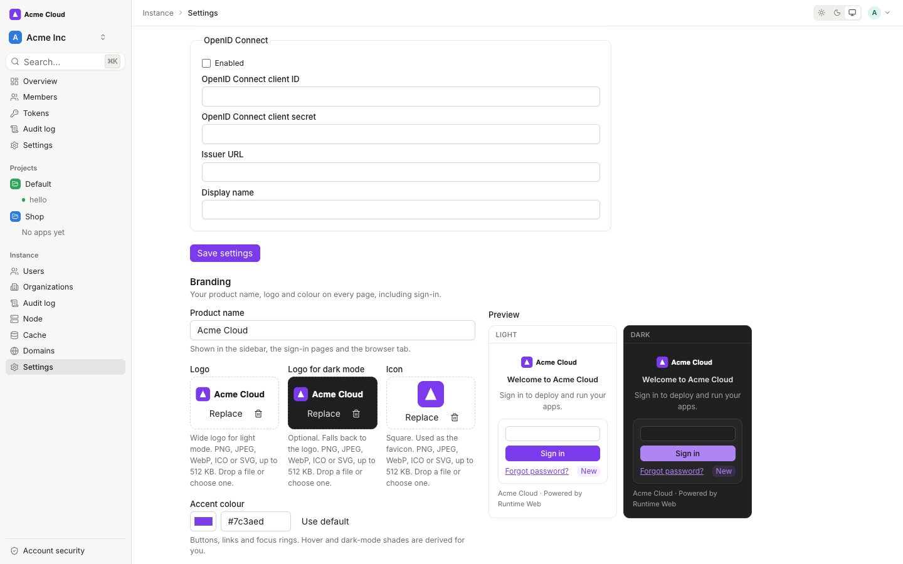
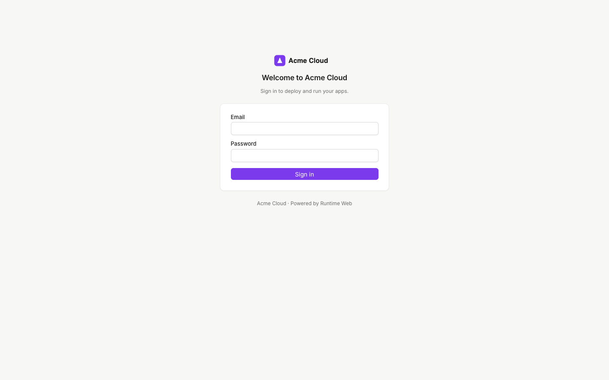

# Branding

Runtime Web can carry your own product name, logo, icon and accent colour, so your users see your brand on every
page, including the sign-in screens. Branding is built in and free. It applies to the whole instance, and only an
instance admin can change it.

What you can set:

| Setting | Where it shows |
|---|---|
| Product name | Browser tab title, sidebar, sign-in, setup and two-step verification pages |
| Logo (light) and logo for dark mode | Sign-in pages and the top of the sidebar. The dark logo is optional and falls back to the light one |
| Icon | Browser favicon; also used on sign-in pages when there is no logo |
| Accent colour | Buttons, links, focus rings, selection and progress bars, in light and dark mode |
| Corners | Sharp, default or round corners on buttons, inputs and cards |
| Neutral tint | Neutral, warm or cool greys for the sidebar and panels |
| Sign-in headline and subtitle | The heading and line of text above the sign-in form |
| Support URL and support email | **Get help** and **Email support** in the account menu |
| Hide "Powered by Runtime Web" | Removes the attribution under the sign-in card |

## Set up your brand

1. Sign in as an instance admin.
2. In the sidebar, under **Instance**, open **Settings** and scroll to **Branding**.
3. Enter a **Product name**. Leave it empty to keep "Runtime Console".
4. Drop a file onto **Logo**, **Logo for dark mode** and **Icon**, or click **Choose file**. Images upload as soon as
   you pick them.
5. Pick an **Accent colour** with the colour picker or type a hex value such as `#7c3aed`.
6. Choose **Corners** and **Neutral tint**, and fill in the sign-in text and support links if you want them.
7. Check the **Preview**, which shows the sign-in card in light and dark mode side by side.
8. Click **Save branding**.

Every open console picks up the new brand on its next page load.

## Reset to the defaults

Click **Reset to defaults** and confirm. The product name, sign-in text, colour, corners, tint and support links go
back to the defaults, and the uploaded images are deleted. To remove a single image, click the bin icon next to it.

## Accent colour and contrast

You enter one colour. Runtime Web derives the rest:

- a hover shade and a soft and pale tint for selections and badges;
- the text colour on top of the accent (white in light mode, near-black in dark mode);
- a lighter dark-mode variant so links stay readable on the dark background.

Every pair is checked against WCAG AA (a contrast of at least 4.5:1). If your colour is too light for text on white,
the editor shows a warning and light mode uses the nearest darker shade that passes. The same happens in dark mode in
the other direction. Your entered value is kept, so a later change to the rules does not lose it.

## Image formats and limits

| Rule | Value |
|---|---|
| Formats | PNG, JPEG, WebP, ICO, SVG |
| Maximum size | 512 KB per image |
| Logo | Wide; shown about 40 px tall on sign-in pages and 28 px tall in the sidebar |
| Icon | Square; at least 64 × 64 px works well as a favicon |

The server reads the format from the file's contents, not from its name, and refuses anything else.

## Security notes

- **No custom CSS.** Branding offers named options (corners, tint) instead of free-form CSS, so the console keeps
  its Content Security Policy and no admin can inject styles or scripts that run for every user.
- **SVG is restricted.** An SVG that contains scripts, event handlers (`onload` and similar), `foreignObject`,
  entity declarations, `javascript:` links or references to other files is refused. Export a plain SVG from your
  design tool. Accepted SVGs are also served with `Content-Security-Policy: sandbox; default-src 'none'`, so opening
  one directly cannot run anything.
- **Same origin only.** Images are stored by Runtime Web and served from your console's own address with
  `X-Content-Type-Options: nosniff`. The console never loads brand images from another site.
- **Public by design.** The brand (name, colour, images, sign-in text, support links) is readable without signing in,
  because the sign-in page needs it. Do not put anything private in these fields.
- **Audited.** Every change and reset is recorded in the instance audit log as `branding.update`, `branding.reset`,
  `branding.asset_update` or `branding.asset_delete`.

## API

The settings are also available over the HTTP API. See
[Branding in the API reference](../reference/api.md#61-branding).
